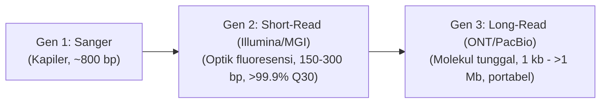
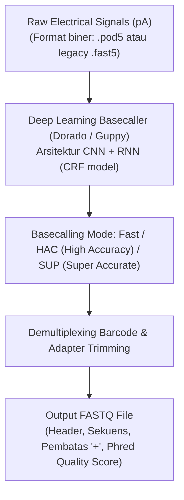

# Modul 01: Pengantar Sekuensing Oxford Nanopore (ONT) untuk Profil 16S

## 🎯 Target Pembelajaran
Setelah menyelesaikan modul ini, peserta mampu:
1. Menjelaskan mekanisme kerja pori protein Oxford Nanopore Technologies (ONT) dan konversi sinyal arus ionik ke deret waktu.
2. Membedakan kimia pori generasi **R9.4.1** (akurasinya Q10–Q13 pada dataset PRJNA637202) dengan generasi modern **R10.4.1** (Q20+ modal accuracy).
3. Memahami alur kerja *basecalling* deep learning modern (**Dorado**) dari format biner `.pod5` menjadi file teks **FASTQ**.
4. Mengenali profil kesalahan (*error profile*) khas Nanopore (*homopolymer insertions/deletions*) dan implikasinya terhadap klasifikasi taksonomi.

---

## 1. Evolusi Teknologi Sekuensing & Posisi Nanopore

Pembacaan asam nukleat telah bertransformasi dari sekuensing Sanger generasi pertama, *short-read sequencing* generasi kedua (Illumina, MGI), hingga *long-read sequencing* generasi ketiga (Oxford Nanopore Technologies [ONT], PacBio HiFi).

| Parameter | Short-Read (Illumina) | Nanopore R9.4.1 (2018–2021) | Nanopore R10.4.1 (Modern / Kit 14) |
|---|---|---|---|
| **Panjang Read** | 150–300 bp | 1.000 bp hingga > 1.000.000 bp | 1.000 bp hingga > 1.000.000 bp |
| **Metode Deteksi** | Fluoresensi optik sintesis DNA | Fluktuasi arus ionik molekul tunggal | Fluktuasi arus ionik (dual-reader head) |
| **Akurasi Per-Basa** | >99.9% (Q30) | ~90–93% (Q10–Q12) | >99% (Q20+) dengan model Dorado SUP |
| **Error Profile** | Substitusi acak (*mismatches*) | Homopolymer indel (delesi/insersi) | Jauh lebih terkalibrasi di daerah homopolimer |
| **Resolusi 16S** | Terbatas pada sub-region (V3–V4) | Menjangkau multi-region / Full-length | Full-length (V1–V9) dengan akurasi tinggi |

> [!NOTE]
> Dataset **PRJNA637202** yang digunakan pada praktikum workshop ini dihasilkan pada tahun 2020 menggunakan instrumen MinION dengan kimia **R9.4.1**. Kualitas rata-rata *reads* berada pada kisaran Phred Q10–Q12 (akurasi ~90–94%). Memahami karakteristik ini sangat krusial agar peserta tidak bingung mengapa filter kualitas diatur pada Phred $Q \ge 10$.

---

## 2. Mekanisme Biofisika Pori Protein Nanopore

Prinsip kerja alat sekuensing Nanopore (seperti MinION, GridION, PromethION) mengandalkan fenomena biofisika membran:

1. **Membran Polimer Sintetis**: Membran resistif elektrik yang tidak dapat ditembus ion memisahkan dua kompartemen larutan elektrolit (*cis* dan *trans*).
2. **Protein Nanopori**: Saluran protein nano (misal CsgG terekayasa) disematkan ke dalam membran.
3. **Arus Ionik Dasar (*Baseline Current*)**: Medan listrik potensial diterapkan melintasi membran sehingga ion ($K^+$, $Cl^-$) mengalir menembus saluran pori, menghasilkan arus nanoampere ($pA$) yang stabil.
4. **Motor Enzim Translokasi**: Molekul motor (helikase) membuka untai ganda DNA dan menuntun untai tunggal meluncur melewati rongga penyempitan pori (*reader constriction*) dengan kecepatan terkontrol (~400–450 basa/detik).
5. **Modulasi Hambatan Arus**: Saat $k$-mer basa nukleotida (kombinasi 5–6 nukleotida) berada di dalam pori, ukuran molekul dan muatannya merintangi aliran ion secara spesifik, menghasilkan pola fluktuasi arus listrik khas terhadap waktu (*squiggles*).

---

## 3. Alur Basecalling: Mengubah Arus Listrik Menjadi FASTQ

Mesin sekuenser Nanopore **tidak menghasilkan huruf DNA secara langsung**.

### Model Basecalling pada Dorado
* **Fast Mode**: Komputasi sangat ringan (bisa berjalan di CPU laptop), akurasi lebih rendah (~Q10–Q12).
* **HAC (High-Accuracy)**: Standar untuk sequencing harian, membutuhkan GPU terdedikasi (akurasi ~Q15–Q18).
* **SUP (Super-Accuracy)**: Model neural network mendalam dengan parameter besar; mencapai modal akurasi >Q20 pada kimia R10.4.1.

---

## 4. Karakteristik Error Nanopore & Implikasinya pada Analisis 16S

Sekuensing Nanopore memiliki kelemahan historis pada daerah **homopolimer** (rentetan basa berulang yang identik, seperti `AAAAAA` atau `GGGGG`):
- Ketika rentetan basa yang sama meluncur melalui pori, fluktuasi arus listrik bersifat datar (tidak ada perubahan gradien arus).
- Akibatnya, basecaller sulit menentukan apakah ada 5 atau 6 basa, memicu kesalahan **delesi atau insersi (indel)**.

### Konsekuensi Bioinformatika:
1. **Kegagalan Algoritma ASV Konvensional (Short-Read)**: Algoritma seperti DADA2 standar atau Deblur mengasumsikan error sekuensing bersifat substitusi independen berfrekuensi rendah. Pada data Nanopore R9.4.1, indel membuat hampir setiap *read* tampak unik, sehingga pendekatan ASV konvensional memecah kelimpahan menjadi ribuan varian palsu.
2. **Kebutuhan Metode Berbasis Resiliensi Indel**: Oleh sebab itu, analisis 16S Nanopore mengandalkan klasifikasi *minimizer* $k$-mer (`Kraken2`) pada tingkat genus, atau penjajaran probabilistik (*alignment-based Expectation-Maximization* seperti **`Emu`**) yang memodelkan profil error Nanopore untuk mencapai resolusi spesies.

---

## 5. Ringkasan Modul
- Oxford Nanopore mendeteksi DNA molekul tunggal secara *real-time* via fluktuasi arus ionik membran.
- Kimia **R9.4.1** (dataset praktikum) memiliki kualitas rerata Q10–Q12, sedangkan **R10.4.1** modern mencapai >Q20.
- Sinyal mentah `.pod5` diterjemahkan menjadi file `.fastq` oleh basecaller deep learning **Dorado**.
- Error homopolimer indel menuntut pemilihan alat bioinformatika yang secara spesifik dirancang tahan terhadap karakteristik error sekuensing panjang.
