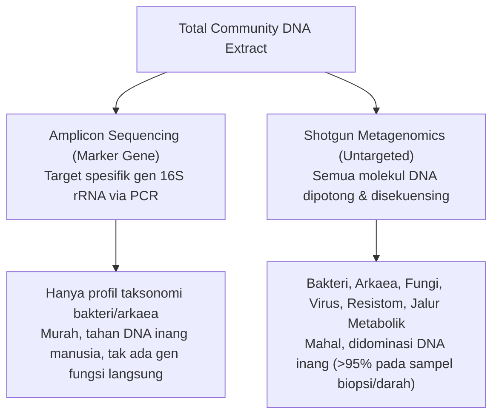
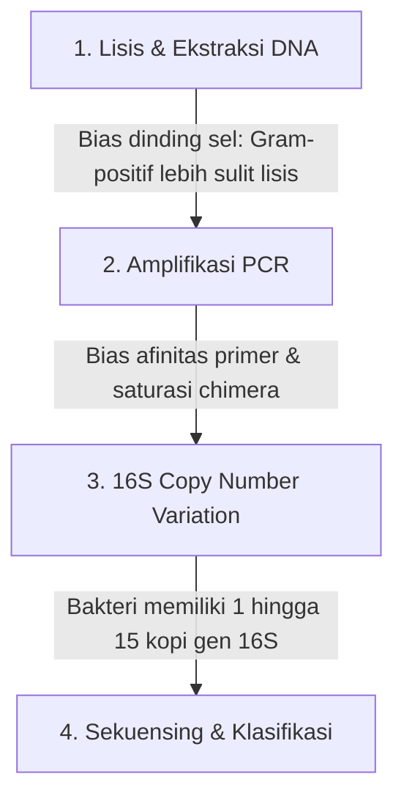

# Modul 02: Desain Studi 16S Amplicon vs Shotgun Metagenomics

## 🎯 Target Pembelajaran
Setelah menyelesaikan modul ini, peserta mampu:
1. Membedakan secara tegas antara analisis **16S rRNA gene amplicon sequencing** (metataxonomics/profiling taksonomi) dengan **shotgun metagenomics**.
2. Memahami anatomi gen 16S rRNA (≈1.500 bp), posisi daerah lestari (*conserved*) dan hipervariabel (V1–V9).
3. Mengenali target amplikon dataset **PRJNA637202** (wilayah **V3–V9**, ≈1.140 bp) dari studi kohort *PreventADALL* (Angell et al., 2020).
4. Mengidentifikasi sumber bias eksperimental: lisis sel/ekstraksi DNA, bias primer PCR, serta variasi jumlah salinan gen 16S (*Copy Number Variation* / CNV).
5. Memahami pentingnya kontrol negatif (*kitome/splashome*) dan kontrol positif (*mock community*) dalam riset mikrobioma klinis.

> [!TIP]
> **⚡ Inti dalam 30 Detik**: **16S amplicon** itu seperti membaca **daftar isi / KTP bakteri saja** (cepat, murah, mengabaikan DNA manusia), sedangkan **shotgun metagenomics** itu membaca **seluruh isi buku** (bakteri, virus, jamur, gen resistensi antibiotik, sekaligus DNA manusia). Ingat pula: data 16S selalu punya bias lab basah, sehingga kontrol negatif dan positif sangat krusial!

---

## 1. 16S rRNA Amplicon Sequencing vs Shotgun Metagenomics

Sering terjadi kerancuan istilah di literatur di mana sekuensing amplikon 16S disebut sebagai "16S Metagenomics". Dalam terminologi ilmiah yang tepat (Marchesi & Ravel, 2015, *Microbiome*, [doi:10.1186/s40168-015-0094-5](https://doi.org/10.1186/s40168-015-0094-5)):



| Parameter | 16S rRNA Amplicon Profiling | Shotgun Metagenomics |
|---|---|---|
| **Target Molekuler** | Gen penanda tunggal (16S rRNA) | Seluruh DNA genomik komunitas |
| **Domain Kehidupan** | Bakteri & Arkaea saja | Bakteri, Arkaea, Fungi, Virus, Eukariota mikroba |
| **Sensitivitas DNA Inang** | **Sangat rendah**: Primer spesifik bakteri, mengabaikan DNA manusia | **Sangat tinggi**: Mayoritas reads pada sampel klinis adalah DNA manusia |
| **Kapasitas Fungsional** | Tidak langsung (hanya prediksi inferensial via PICRUSt2) | Langsung mengukur kelimpahan gen fungsional, toksin, & AMR |
| **Kebutuhan Komputasi** | Ringan–Sedang (dapat dijalankan di Google Colab) | Sangat besar (butuh ratusan GB RAM & GPU/HPC) |

---

## 2. Struktur Gen 16S rRNA & Target Amplikon Dataset

Gen 16S rRNA (≈1.500 bp) menyandi RNA subunit kecil (30S) dari ribosom prokariota. Gen ini memiliki struktur mosaik:
- **Wilayah Lestari (Conserved Regions)**: Sekuens nukleotida sangat identik di semua filum bakteri karena fungsi esensialnya dalam translasi protein. Wilayah ini berfungsi sebagai tempat penempelan primer PCR universal (mis. 27F, 1492R).
- **Wilayah Hipervariabel (V1–V9)**: Sembilan wilayah yang mengalami akumulasi mutasi divergensi evolusioner. Variasi sekuens inilah yang menjadi "sidik jari taksonomi" untuk membedakan genus dan spesies.

```text
Struktur Gen 16S rRNA Bakteri (~1.500 bp):
[Conserved]--[V1]--[Conserved]--[V2]--[Conserved]--[V3]--...--[V9]--[Conserved]
             |<---------------- Full-Length V1-V9 (~1.500 bp) ------------->|
                                     |<--- V3-V9 (~1.140 bp; PRJNA637202) ->|
```

### Karakteristik Dataset PRJNA637202 (Studi Kasus Hands-on)
Dataset yang kita gunakan berasal dari publikasi:
> **Angell, I. L., et al. (2020).** *"De novo species identification using 16S rRNA gene nanopore sequencing."* *PeerJ*, 8, e10029. DOI: [10.7717/peerj.10029](https://doi.org/10.7717/peerj.10029).

- **Kohort**: Feses bayi usia 3 bulan dari studi *PreventADALL* (Preventing Atopic Dermatitis and ALLergies in children).
- **Desain PCR**: Menggunakan primer yang menargetkan wilayah **V3 hingga V9** (≈1.140 bp), bukan V1–V9 utuh.
- **Implikasi Praktikum**: Distribusi panjang *reads* berpusat di sekitar **1,14 kb**. Oleh karena itu, batasan panjang pada tahap filtering disetel ke **1.000–1.700 bp** (bukan 1.300–1.700 bp). Jika kita memaksakan batas minimum 1.300 bp, >90% data valid akan terbuang secara salah!

---

## 3. Sumber Bias Eksperimental dalam Profiling Mikrobioma

Hasil sekuensing 16S **bukanlah cerminan mutlak 1:1** dari populasi sel bakteri di dalam usus. Sejumlah bias fisik dan biologis terjadi sepanjang alur kerja:



1. **Bias Ekstraksi DNA**: Bakteri Gram-positif (seperti filum Bacillota dan Actinomycetota) memiliki dinding peptidoglikan yang sangat tebal. Tanpa lisis mekanis (*bead-beating*), DNA bakteri Gram-positif akan kurang terwakili dibanding bakteri Gram-negatif (Bacteroidota/Pseudomonadota).
2. **Bias Primer PCR**: Tidak ada primer yang benar-benar 100% "universal". Perbedaan satu nukleotida pada *primer binding site* dapat menurunkan efisiensi amplifikasi takson tertentu.
3. **16S Copy Number Variation (CNV)**: Jumlah operon rRNA per genom bakteri sangat bervariasi:
   - *Bifidobacterium longum*: 4 kopi
   - *Bacteroides fragilis*: 6 kopi
   - *Escherichia coli*: 7 kopi
   - *Clostridioides difficile* (sebelumnya *Clostridium difficile*): 11–12 kopi
   Akibatnya, bakteri dengan jumlah kopi gen 16S tinggi akan menghasilkan sinyal *reads* yang melimpah secara artifisial, meskipun jumlah sel fisiknya sama dengan bakteri berkopi 1.

> [!TIP]
> **💡 Analogi Sederhana (Kartu Nama di Kotak Undian)**: Bayangkan 1 sel *C. difficile* memasukkan **12 kartu nama** ke kotak undian, sementara bakteri lain hanya memasukkan **1 kartu nama**. Saat kita mengambil acak dari kotak (sekuensing), *C. difficile* tampak 12 kali lebih ramai—padahal jumlah sel aslinya sama-sama satu!

---

## 4. Pengendalian Kualitas Laboratorium: Kontrol Negatif & Positif

Dalam penelitian klinis dan forensik mikrobioma, dua kontrol eksperimental adalah **wajib hukumnya**:

1. **Kontrol Negatif (Negative Extraction Control & No-Template PCR Control)**:
   - Kit ekstraksi DNA, enzim polimerase, dan air laboratorium membawa jejak fragmen DNA mikroba lingkungan dalam konsentrasi rendah (disebut **"Kitome"** atau **"Splashome"**, mis. *Ralstonia*, *Burkholderia*, *Bradyrhizobium*).
   - Pada sampel klinis biomassa rendah (mis. cairan serebrospinal, darah, cairan sendi), sinyal kontaminan reagen ini dapat mendominasi hasil sekuensing. Kontrol negatif harus disekuensing bersama sampel untuk memungkinkan dekontaminasi bioinformatika (mis. via package `decontam`).
2. **Kontrol Positif (*Mock Community*)**:
   - Campuran terkalibrasi dari galur bakteri terkarakterisasi (mis. ZymoBIOMICS Microbial Community Standard dengan komposisi sel genotifik yang diketahui persis).
   - Berguna untuk mengukur akurasi per-basa, mendeteksi pembentukan *chimeric reads*, dan mengevaluasi laju *false positive* algoritma klasifikasi taksonomi.

---

## 5. Ringkasan Modul
- Sekuensing amplikon 16S adalah profil taksonomi gen penanda, bukan sekuensing menyeluruh (*shotgun*).
- Dataset PRJNA637202 menargetkan wilayah **V3–V9 (≈1.140 bp)** pada mikrobioma usus bayi.
- Sinyal kelimpahan 16S dipengaruhi oleh bias ekstraksi, bias PCR, dan variasi jumlah kopi operon 16S per genom.
- Deteksi takson tanpa kontrol negatif (*kitome*) dan kontrol positif (*mock community*) berisiko tinggi menimbulkan kesimpulan biologis yang salah.

### ✅ Cek Paham Cepat (1 Menit)
1. Jika Anda ingin mencari gen resistensi antibiotik (AMR) atau virus dalam sampel klinis, apakah 16S amplicon cocok? Mengapa?
2. Mengapa batas bawah panjang filter pada dataset kita diatur ke **1.000 bp**, bukan 1.300 bp?
