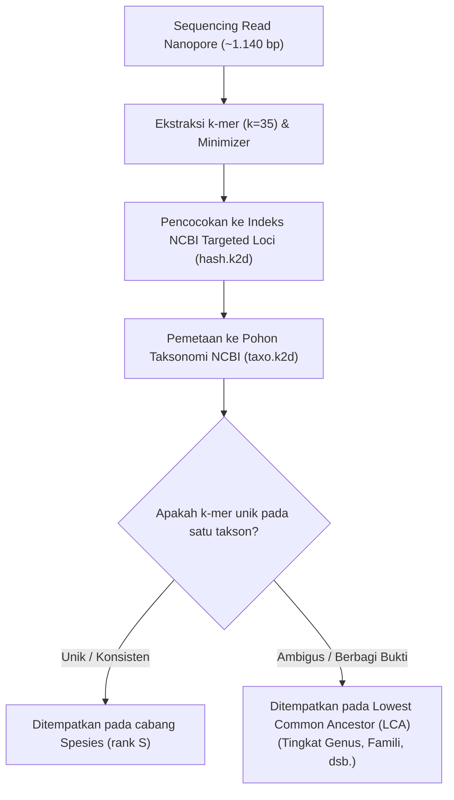

# Modul 04: Klasifikasi Taksonomi: Kraken2 & Database NCBI Targeted Loci (Spesies & Genus)

## 🎯 Target Pembelajaran
Setelah menyelesaikan modul ini, peserta mampu:
1. Menjelaskan mekanisme klasifikasi taksonomi berbasis pencocokan $k$-mer minimizer dan penugasan *Lowest Common Ancestor* (LCA) pada **Kraken2**.
2. Memahami arsitektur database resmi **NCBI Targeted Loci 16S/18S** dari Oxford Nanopore Technologies (ONT EPI2ME Labs) dan keunggulannya dalam menyediakan taksonomi tingkat **Spesies** (`rank = S`).
3. Membedakan secara kritis antara **Keberadaan Label Spesies** pada database dengan **Kepastian Biologis Identifikasi Spesies** pada gen 16S rRNA.
4. Memahami struktur file model distribusi k-mer Bracken (`database1000mers.kmer_distrib`) dan pertimbangan metodologis penggunaannya.
5. Mengenali peran komplementer perangkat lunak berbasis penjajaran dan algoritma *Expectation-Maximization* (**`Emu`**) untuk penentuan spesies pada data Nanopore 16S.

---

## 1. Algoritma Kraken2: Pencocokan Minimizer $k$-mer & LCA

Alih-alih melakukan penyejajaran sekuens penuh (*alignment*) yang memakan waktu komputasi besar, **Kraken2** menggunakan indeks $k$-mer terkompresi berbasis tabel *hash*:



### Prinsip Lowest Common Ancestor (LCA)
Jika sekumpulan $k$-mer sepanjang 35 bp ditemukan identik pada beberapa spesies berkerabat dekat (misal di antara spesies dalam genus *Bacteroides* atau famili *Enterobacteriaceae*), Kraken2 tidak akan menebak secara sembarangan, melainkan menaikkan penugasan ke simpul leluhur bersama terdekat (*Lowest Common Ancestor* / LCA).

### Parameter Confidence Threshold (`--confidence 0.05`)
Secara default, satu kecocokan $k$-mer minimizer saja sudah dapat melabeli suatu takson. Pada data Nanopore yang memiliki variasi error per-basa lebih tinggi, kita menerapkan:
```bash
kraken2 --db database_16s --confidence 0.05 --threads 2 --report sample.k2report input.fastq
```
Flag `--confidence 0.05` mensyaratkan minimal 5% dari seluruh $k$-mer informatif pada *read* tersebut harus konsisten mendukung cabang taksonomi terkait, secara efektif menyaring penugasan acak (*false positive assignments*).

---

## 2. Mengenal Database NCBI Targeted Loci 16S/18S (ONT EPI2ME)

Dalam alur kerja resmi Oxford Nanopore Technologies (EPI2ME Labs `wf-16s` dan `wf-metagenomics`), ONT menyediakan paket database Kraken2 siap pakai berbasis **NCBI Targeted Loci**:

* **Sumber Sekuens**: NCBI RefSeq Targeted Loci Project (kurasi gen ribosomal 16S prokariota dan 18S eukariota dari *type material* / strain tipe terverifikasi).
* **Format & Arsip**: `ncbi_targeted_loci_kraken2.tar.gz` (Ukuran unduhan sangat ringkas: **~8.63 MB**).
* **Pohon Taksonomi**: Menggunakan hirarki taksonomi resmi NCBI (NCBI Taxonomy IDs), sehingga seluruh entri terpetakan secara terstruktur dari Domain hingga ke **Spesies (`rank = S`)**.
* **Komponen Database**:
  - `hash.k2d`: Tabel hash pencocokan minimizer k-mer.
  - `opts.k2d`: Parameter panjang $k$ dan $m$ minimizer saat kompilasi.
  - `taxo.k2d`: Nodus, relasi induk-anak, dan nama taksonomi NCBI.
  - `database1000mers.kmer_distrib`: Model distribusi k-mer 1.000 bp untuk panjang bacaan ~1 kb.

---

## 3. Evaluasi Kritis: Kapan Identifikasi Spesies 16S Dapat Dipercaya?

Meskipun laporan Kraken2 kini menampilkan baris bertanda **`S` (Species)** seperti *Bifidobacterium longum*, *Bacteroides fragilis*, atau *Escherichia coli*, peneliti dan klinisi wajib memahami batasan biologisnya:

```text
Hirarki Keyakinan Identifikasi:
[ Level Genus ]   --> Keyakinan Sangat Tinggi (Konservasi 16S memadai untuk genus)
[ Level Spesies ] --> Keyakinan Moderat hingga Tinggi (Tergantung kompleksitas filogenetik takson)
[ Level Galur ]   --> TIDAK BISA (Gen 16S rRNA tidak memiliki resolusi strain)
```

### Empat Peringatan Ilmiah Penting:
1. **Spesies Bersekuens 16S Identik**:
   - Sekuens gen 16S rRNA dari *Escherichia coli* dan *Shigella flexneri* memiliki kemiripan >99% (seringkali identik 100%). Panggilan spesies pada kelompok ini bersifat indikatif dan tidak boleh dijadikan dasar diagnosis medis definitif.
   - Anggota kompleks *Bacillus cereus* sensu lato (*B. anthracis*, *B. cereus*, *B. thuringiensis*) memiliki gen 16S yang nyaris indistinguishable.
2. **Keterbatasan Amplikon Parsial V3–V9**:
   - Dataset praktikum kita (PRJNA637202) mencakup ~1.140 bp (V3–V9). Sekitar 350 bp di wilayah 5' (V1–V2) tidak teramplifikasi oleh primer wet-lab. Beberapa spesies bakteri justru memiliki variasi diagnostik pembeda di wilayah V1–V2.
3. **Variasi Jumlah Salinan Gen (*Copy Number Variation* / CNV)**:
   - Jumlah operon gen 16S bervariasi antarspesies (1 hingga 15 kopi). Sinyal kelimpahan sekuens mencerminkan jumlah kopi gen, bukan jumlah sel fisik secara langsung.
4. **Strategi Pelaporan Dual-Rank**:
   - Di notebook praktikum, kita menganalisis data pada **Tingkat Spesies** (untuk mengeksplorasi takson dominan) sekaligus menyediakan rekapitulasi pada **Tingkat Genus** sebagai kontrol analitis yang kokoh.

---

## 4. Peran Komplementer `Emu` (Expectation-Maximization)

Bagi penelitian mikrobioma yang secara khusus membutuhkan profiling tingkat spesies dengan akurasi analitis tertinggi dari data bacaan panjang Nanopore, alat mutakhir yang direkomendasikan di literatur adalah **`Emu`** (Curry et al., 2022, *Nature Methods*):

* **Prinsip Kerja Emu**: Menggunakan penjajaran *semi-global* `minimap2` terhadap database gabungan rrnDB + NCBI, kemudian memecahkan ambiguitas multi-mapping antarspesies dekat menggunakan algoritma iteratif *Expectation-Maximization* (EM).
* **Perbandingan Praktis**: Kraken2 dengan database NCBI Targeted Loci memberikan kecepatan komputasi instan (<1 menit untuk 12 sampel di Google Colab) sehingga sangat ideal untuk hands-on workshop, sementara `Emu` menjadi rujukan ilmiah lanjutan untuk analisis mendalam pasca-workshop.

---

## 5. Ringkasan Modul
- Kraken2 memetakan reads secara instan menggunakan pencocokan minimizer k-mer dan penugasan LCA.
- Database **NCBI Targeted Loci 16S/18S** dari ONT EPI2ME Labs berukuran sangat ringkas (~8.6 MB) dan mendukung identifikasi hingga tingkat **Spesies** (`rank = S`).
- Penugasan taksonomi tingkat spesies pada 16S harus diinterpretasikan secara bertanggung jawab dengan menyadari adanya spesies berkerabat dekat yang memiliki sekuens 16S identik.
- Analisis komparatif pada tingkat Genus tetap disediakan sebagai kontrol metodologis yang saling melengkapi.
