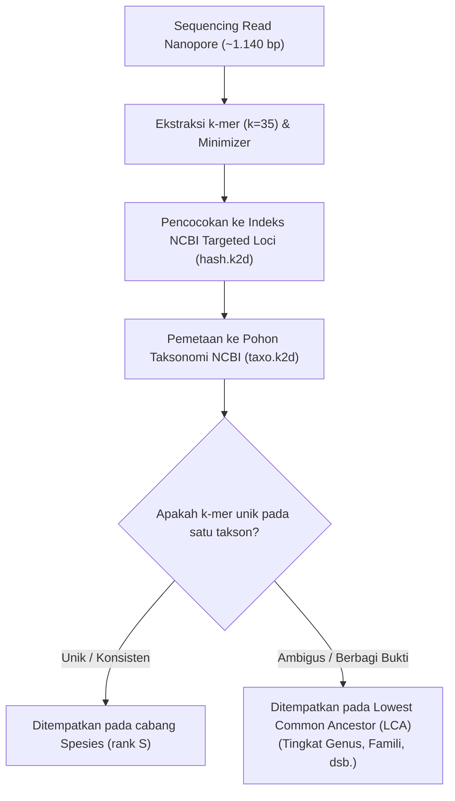

# Modul 04: Klasifikasi Taksonomi: Kraken2 & Database NCBI Targeted Loci (Spesies & Genus)

## 🎯 Target Pembelajaran
Setelah menyelesaikan modul ini, peserta mampu:
1. Menjelaskan mekanisme klasifikasi taksonomi berbasis pencocokan $k$-mer minimizer dan penugasan *Lowest Common Ancestor* (LCA) pada **Kraken2**.
2. Memahami arsitektur database resmi **NCBI Targeted Loci 16S/18S** dari Oxford Nanopore Technologies (ONT EPI2ME Labs) dan keunggulannya dalam menyediakan taksonomi tingkat **Spesies** (`rank = S`).
3. Membedakan secara kritis antara **Keberadaan Label Spesies** pada database dengan **Kepastian Biologis Identifikasi Spesies** pada gen 16S rRNA.
4. Memahami struktur file model distribusi k-mer Bracken (`database1000mers.kmer_distrib`) dan pertimbangan metodologis penggunaannya.
5. Mengenali peran komplementer perangkat lunak berbasis penjajaran dan algoritma *Expectation-Maximization* (**`Emu`**) untuk penentuan spesies pada data Nanopore 16S.

> [!TIP]
> **⚡ Inti dalam 30 Detik**: **Kraken2** adalah "mesin pencari super cepat" yang memotong sekuens DNA menjadi potongan kata pendek ($k$-mer) lalu mencocokkannya ke kamus resmi **NCBI Targeted Loci** (~8,6 MB). Jika buktinya unik, ia melabeli hingga **Spesies**; jika ambigu di antara beberapa spesies dekat, ia bersikap jujur dengan naik ke **Genus/Famili (LCA)**.

---

## 1. Algoritma Kraken2: Pencocokan Minimizer $k$-mer & LCA

Alih-alih melakukan penyejajaran sekuens penuh (*alignment*) yang memakan waktu komputasi besar, **Kraken2** menggunakan indeks $k$-mer terkompresi berbasis tabel *hash*:



### Prinsip Lowest Common Ancestor (LCA)
Jika sekumpulan $k$-mer sepanjang 35 bp ditemukan identik pada beberapa spesies berkerabat dekat (misal di antara spesies dalam genus *Bacteroides* atau famili *Enterobacteriaceae*), Kraken2 tidak akan menebak secara sembarangan, melainkan menaikkan penugasan ke simpul leluhur bersama terdekat (*Lowest Common Ancestor* / LCA).

> [!TIP]
> **💡 Analogi Sederhana (Detektif Kamus yang Jujur)**: Bayangkan Anda menemukan sobekan halaman bertuliskan *"berkaki empat, berkumis, suka ikan"*. Karena cocok dengan kucing kampung maupun kucing Persia, detektif yang jujur akan melapor: *"Ini keluarga Kucing (Genus)"*—bukan asal menebak rasnya! Itulah cara kerja **LCA** pada Kraken2.

### Parameter Confidence Threshold (`--confidence 0.01`)
Secara default (`0.0`), satu kecocokan $k$-mer minimizer saja sudah dapat melabeli suatu takson. Pada data Nanopore R9.4.1 (akurasi ~90%, peluang 35-mer bebas error $(0{,}90)^{35} \approx 2{,}5\%$), kita menerapkan ambang seimbang:
```bash
kraken2 --db database_16s --confidence 0.01 --threads 2 --report sample.k2report input.fastq
```
Flag `--confidence 0.01` mensyaratkan minimal 1% dari seluruh $k$-mer informatif pada *read* tersebut harus konsisten mendukung cabang taksonomi terkait—efektif menyaring penugasan acak (*false positive*) tanpa membuang sinyal biologis R9.4.1.

---

## 2. Mengenal Database NCBI Targeted Loci 16S/18S (ONT EPI2ME)

Dalam alur kerja resmi Oxford Nanopore Technologies (EPI2ME Labs `wf-16s` dan `wf-metagenomics`), ONT menyediakan paket database Kraken2 siap pakai berbasis **NCBI Targeted Loci**:

* **Sumber Sekuens**: NCBI RefSeq Targeted Loci Project (kurasi gen ribosomal 16S prokariota dan 18S eukariota dari *type material* / strain tipe terverifikasi).
* **Format & Arsip**: `ncbi_targeted_loci_kraken2.tar.gz` (Ukuran unduhan sangat ringkas: **~8.63 MB**).
* **Pohon Taksonomi**: Menggunakan hirarki taksonomi resmi NCBI (NCBI Taxonomy IDs), sehingga seluruh entri terpetakan secara terstruktur dari Domain hingga ke **Spesies (`rank = S`)**.
* **Komponen Database**:
  - `hash.k2d`: Tabel hash pencocokan minimizer k-mer.
  - `opts.k2d`: Parameter panjang $k$ dan $m$ minimizer saat kompilasi.
  - `taxo.k2d`: Nodus, relasi induk-anak, dan nama taksonomi NCBI.
  - `database1000mers.kmer_distrib`: Model distribusi k-mer 1.000 bp untuk panjang bacaan ~1 kb.

### Pilihan Database 16S Lain untuk Kraken2 (Riset Mandiri)
Selain `ncbi_16s_18s`, beberapa alternatif indeks 16S yang umum dipakai bersama `Kraken2` antara lain:

| Database | Perkiraan Ukuran | Keunggulan Utama | Kapan Cocok Dipakai? |
|---|---|---|---|
| **NCBI Targeted Loci 16S/18S** *(dipakai di sini)* | ~8,6 MB | Sangat ringan, taksonomi NCBI hingga Spesies (`S`), resmi ONT EPI2ME | Workshop Colab & eksplorasi dual-rank cepat |
| **SILVA 138 / 138.1** | ~112–297 MB | Cakupan bakteri klinis & lingkungan sangat luas | Profil tingkat **Genus** pada sampel klinis/lingkungan |
| **RDP** *(Ribosomal Database Project)* | ~20–30 MB | Kurasi ketat prokariota, ringan | Pembanding cepat tingkat **Genus** |
| **Greengenes2** (`Greengenes2_plus` EPI2ME) | ~162 MB | Selaras dengan pohon genom utuh (*Web of Life*); populer di QIIME2 | Riset mikrobioma usus yang disandingkan dengan *shotgun* |

*(Hindari memuat database shotgun besar seperti `Standard` ~70 GB pada Google Colab gratis ber-RAM 12 GB.)*

---

## 3. Evaluasi Kritis: Kapan Identifikasi Spesies 16S Dapat Dipercaya?

Meskipun laporan Kraken2 kini menampilkan baris bertanda **`S` (Species)** seperti *Bifidobacterium longum*, *Bacteroides fragilis*, atau *Escherichia coli*, peneliti dan klinisi wajib memahami batasan biologisnya:

```text
Hirarki Keyakinan Identifikasi pada 16S rRNA Standar:
[ Level Genus ]   --> Tinggi (>90% kasus klinis; batas kemiripan ~94,5%)
[ Level Spesies ] --> Moderat hingga Tinggi (~65–83%; batas ~98,65%, bergantung klad takson & kualitas bacaan)
[ Level Galur ]   --> Tidak Memadai untuk Strain Typing Rutin (membutuhkan analisis kopi operon akurasi tinggi atau WGS/shotgun)
```

> **Landasan Pustaka**: Konsensus batas resolusi ini mengacu pada review diagnostik klinis **Janda & Abbott (2007)** (*J. Clin. Microbiol.*, [doi:10.1128/JCM.01228-07](https://doi.org/10.1128/JCM.01228-07); identifikasi >90% pada Genus vs ~65–83% pada Spesies), ambang batas kemiripan sekuens **Yarza et al. (2014)** (*Nat. Rev. Microbiol.*, [doi:10.1038/nrmicro3330](https://doi.org/10.1038/nrmicro3330); ~94,5% Genus) dan **Kim et al. (2014)** (*IJSEM*, [doi:10.1099/ijs.0.059774-0](https://doi.org/10.1099/ijs.0.059774-0); 98,65% Spesies), serta evaluasi resolusi spesies–galur *full-length* 16S oleh **Johnson et al. (2019)** (*Nat. Commun.*, [doi:10.1038/s41467-019-13036-1](https://doi.org/10.1038/s41467-019-13036-1)). Meski *full-length* 16S berakurasi sangat tinggi secara teori dapat membedakan sebagian galur lewat pola variasi antarkopi operon, pada alur *single-read* R9.4.1 + `Kraken2` maupun *strain typing* klinis (mis. virulensi/AMR yang berada di luar gen 16S), analisis galur tetap memerlukan **WGS atau *shotgun* metagenomics**.

### Empat Peringatan Ilmiah Penting:
1. **Spesies Bersekuens 16S Identik**:
   - Sekuens gen 16S rRNA dari *Escherichia coli* dan *Shigella flexneri* memiliki kemiripan >99% (seringkali identik 100%). Panggilan spesies pada kelompok ini bersifat indikatif dan tidak boleh dijadikan dasar diagnosis medis definitif.
   - Anggota kompleks *Bacillus cereus* sensu lato (*B. anthracis*, *B. cereus*, *B. thuringiensis*) memiliki gen 16S yang nyaris indistinguishable.
2. **Keterbatasan Amplikon Parsial V3–V9**:
   - Dataset praktikum kita (PRJNA637202) mencakup ~1.140 bp (V3–V9). Sekitar 350 bp di wilayah 5' (V1–V2) tidak teramplifikasi oleh primer wet-lab. Beberapa spesies bakteri justru memiliki variasi diagnostik pembeda di wilayah V1–V2.
3. **Variasi Jumlah Salinan Gen (*Copy Number Variation* / CNV)**:
   - Jumlah operon gen 16S bervariasi antarspesies (1 hingga 15 kopi). Sinyal kelimpahan sekuens mencerminkan jumlah kopi gen, bukan jumlah sel fisik secara langsung.
4. **Strategi Pelaporan Dual-Rank**:
   - Di notebook praktikum, kita menganalisis data pada **Tingkat Spesies** (untuk mengeksplorasi takson dominan) sekaligus menyediakan rekapitulasi pada **Tingkat Genus** sebagai kontrol analitis yang kokoh.

---

## 4. Perbandingan Pendekatan Klasifikasi 16S Nanopore (`Kraken2`, `Bracken`, `minimap2`, & `Emu`)

Dalam ekosistem analisis 16S bacaan panjang Nanopore, **tidak ada satu algoritma tunggal yang unggul mutlak di semua situasi**. Masing-masing pendekatan—baik berbasis *$k$-mer* maupun *alignment*—memiliki mekanisme dan *trade-off* nyata:

1. **`Kraken2` (*k-mer* eksak + LCA)** *(dipakai di workshop ini)*: sangat cepat, hemat memori untuk database 16S, dan transparan berkat LCA (jika sekuens ambigu, otomatis naik ke Genus/Family). Keterbatasannya: pencocokan 35-mer eksak sensitif terhadap error *indel* R9.4.1 (pada Q10, peluang 35-mer utuh hanya $(0{,}90)^{35} \approx 2{,}5\%$), sehingga banyak *read* tertahan di Genus dan sebagian kecil *k-mer* dapat memicu *false positive* di tingkat Spesies.
2. **`Kraken2 → Bracken`** *(pengayaan)*: mengambil *read* yang tertahan LCA di tingkat atas (Family/Genus) lalu membaginya ulang secara probabilistik ke spesies di bawahnya memakai file `database1000mers.kmer_distrib`. Pada praktikum ini kita sengaja memakai laporan `Kraken2` langsung tanpa Bracken agar perilaku LCA tetap transparan dan tidak memperbesar *false positive* akibat error *indel* R9.4.1.
3. **`minimap2` + filter/LCA** *(mode alignment pada ONT EPI2ME `wf-16s`)*: menoleransi *indel* dan *mismatch* sepanjang seluruh amplikon 16S (~1,1–1,5 kb) tanpa patah seperti 35-mer eksak. Namun, *mapping* referensi mentah (*top-hit*) memiliki keterbatasan besar di tingkat Spesies karena kemiripan 16S antarspesies menyebabkan *multi-mapping*; tanpa ambang identitas ketat dan LCA, estimasi spesies mudah terpecah (*over-splitting*).
4. **`Emu`** (Curry et al., 2022, *Nature Methods*, [doi:10.1038/s41592-022-01520-4](https://doi.org/10.1038/s41592-022-01520-4)): memadukan penjajaran *semi-global* `minimap2` (tahan *indel*) dengan algoritma iteratif *Expectation-Maximization* (EM) lintas seluruh sampel untuk memecahkan ambiguitas *multi-mapping* antarspesies. Keterbatasannya: komputasi lebih lambat/berat, sangat bergantung pada kelengkapan database bawaannya (rrnDB + NCBI), dan secara default menghasilkan estimasi kelimpahan relatif (bukan panggilan per-*read*).

> **Catatan Kritis**: Performa keempat metode di atas sangat dipengaruhi oleh **kimia *flow cell*** (R9.4.1 vs R10.4.1 Q20+), **panjang amplikon** (V3–V9 vs V1–V9), dan **kelengkapan database rujukan**. Untuk riset publikasi, praktik terbaik adalah memvalidasi pipeline pilihan Anda memakai kontrol positif (*mock community*).

### Perbandingan Objektif Empat Pendekatan

| Pendekatan | Mekanisme Utama | Kelebihan Utama | Keterbatasan Utama |
|---|---|---|---|
| **Kraken2 + NCBI Targeted Loci** *(Alur Workshop)* | Pencocokan 35-mer eksak + LCA | Sangat cepat (<1 dtk/sampel), RAM ringan (<20 MB), stabil & transparan di tingkat **Genus** | 35-mer eksak patah oleh *indel* R9.4.1; sensitivitas Spesies turun & rawan *false positive* ringan |
| **Kraken2 + Bracken (1.000 bp)** | Re-estimasi Bayesian di atas laporan Kraken2 | Sangat cepat; mengembalikan *read* LCA ke tingkat Spesies/Genus | Berisiko memperbesar *false positive* (*over-assignment*) jika data masih tinggi error *indel* (R9.4.1) |
| **`minimap2` + filter/LCA** *(EPI2ME `wf-16s`)* | Penjajaran *long-read* penuh (`-x map-ont`) + filter/LCA | Tahan *indel* sepanjang amplikon; kuat di tingkat **Genus** | *Multi-mapping* antarspesies 16S tinggi; estimasi **Spesies** rentan meleset jika filter identitas longgar |
| **`Emu` (`minimap2` + EM)** | Penjajaran `minimap2` + *Expectation-Maximization* lintas sampel | Meredam *indel* sekaligus memecahkan *multi-mapping* antarspesies secara probabilistik | Lebih lambat & butuh RAM/CPU lebih besar; bergantung pada cakupan database bawaannya |

---

## 5. Ringkasan Modul
- Kraken2 memetakan reads secara instan menggunakan pencocokan minimizer k-mer dan penugasan LCA.
- Database **NCBI Targeted Loci 16S/18S** dari ONT EPI2ME Labs berukuran sangat ringkas (~8.6 MB) dan mendukung identifikasi hingga tingkat **Spesies** (`rank = S`).
- Penugasan taksonomi tingkat spesies pada 16S harus diinterpretasikan secara bertanggung jawab dengan menyadari adanya spesies berkerabat dekat yang memiliki sekuens 16S identik.
- Analisis komparatif pada tingkat Genus tetap disediakan sebagai kontrol metodologis yang saling melengkapi.

### ✅ Cek Paham Cepat (1 Menit)
1. Jika sebuah *read* cocok dengan *Bacteroides fragilis* sekaligus *Bacteroides ovatus*, ke tingkat manakah Kraken2 LCA akan menempatkannya?
2. Mengapa label spesies *Escherichia coli* pada hasil 16S rRNA tidak boleh langsung disimpulkan pasti bukan *Shigella*?
