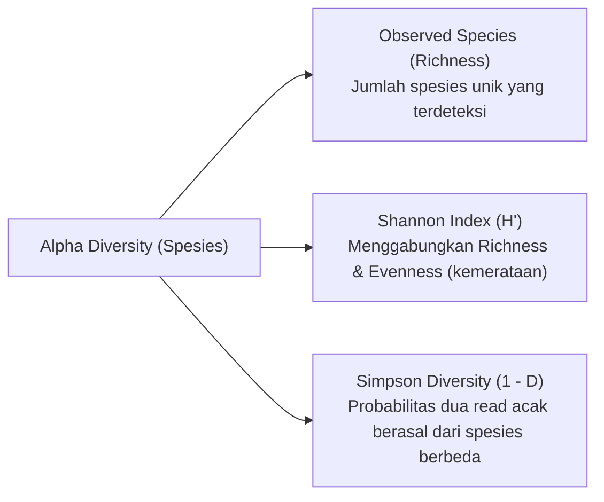

# Modul 05: Visualisasi, Ekologi Komunitas & Analisis Diversity (Genus & Spesies)

## 🎯 Target Pembelajaran
Setelah menyelesaikan modul ini, peserta mampu:
1. Memahami konsep ekologi komunitas mikroba: **Alpha Diversity** (keanekaragaman di dalam sampel) dan **Beta Diversity** (perbedaan komposisi antar-sampel) pada tingkat **Genus** (kedalaman tinggi untuk statistik) dan eksplorasi **Spesies**.
2. Menghitung dan menginterpretasikan metrik keanekaragaman: **Observed Taxa**, **Shannon Index ($H'$)**, dan **Simpson Index ($1-D$)**.
3. Menjelaskan perlunya standardisasi kedalaman sampling melalui **Rarefaction** sebelum membandingkan keragaman antar-sampel.
4. Menghitung jarak ketidaksamaan komposisi menggunakan **Bray–Curtis Dissimilarity** dan memvisualisasikannya via **Principal Coordinates Analysis (PCoA)**.
5. Menguji signifikansi perbedaan struktur komunitas antar-kelompok (persalinan Vaginal vs Sesar) dengan **PERMANOVA** serta mengoreksi pengujian hipotesis multipel dengan **Benjamini–Hochberg False Discovery Rate (FDR)**.
6. Mengoperasikan visualisasi radial bertingkat interaktif menggunakan **Krona Plot** berbasis taksonomi NCBI.

> [!TIP]
> **⚡ Inti dalam 30 Detik**: Jangan takut dengan istilah statistik! Ingat 4 gambar besar saja:
> - **Krona Plot** = diagram lingkaran interaktif untuk *melihat isi satu sampel*.
> - **Rarefaction** = *menyamakan jumlah tarikan jaring* agar perbandingan antar-sampel adil.
> - **Alpha Diversity** = seberapa *beragam isi di dalam satu sampel* (kaya jenis & merata).
> - **Beta Diversity + PCoA + PERMANOVA** = *peta jarak* untuk melihat apakah kelompok Vaginal dan Sesar benar-benar terpisah!

---

## 1. Visualisasi Interaktif Komposisi Taksonomi dengan Krona Plot

Menyajikan data ribuan baris taksonomi dalam bentuk tabel teks sangat sulit dipahami oleh klinisi. **Krona Plot** menyediakan visualisasi bagan lingkaran radial bertingkat (*multi-layered pie chart*):

* **Lingkaran Terdalam**: Mewakili domain dan filum (mis. *Bacteroidota*, *Bacillota*, *Actinomycetota*).
* **Lingkaran Terluar**: Merinci hingga ke tingkat genus dan **spesies**.
* **Fitur Interaktif**: Pengguna dapat mengklik sektor tertentu untuk memperbesar (*zoom-in*), menelusuri proporsi spesies dominan, dan mencari takson tertentu secara instan di peramban web.

### Mengapa Menggunakan `ktImportText`?
Karena file laporan Kraken2 (`.k2report`) memuat struktur hirarki indentasi teks yang lengkap dari Domain hingga Spesies, kita mengekstrak jalur nama taksonomi langsung menjadi format input `ktImportText`. Pendekatan ini memastikan diagram Krona ter-render 100% konsisten dengan pohon taksonomi NCBI tanpa ketergantungan pada file dump eksternal.

---

## 2. Standardisasi Kedalaman Sekuensing: Mengapa Perlu Rarefaction?

Dalam percobaan sekuensing, jumlah *reads* yang diperoleh per sampel hampir selalu berbeda-beda (mis. Sampel V01 menghasilkan ~36.000 *reads*, sedangkan Sampel C06 menghasilkan ~26.000 *reads*).

```text
Masalah Kedalaman Tidak Rata:
Sampel A (36.000 reads) = Mendeteksi 45 spesies (peluang menemukan spesies langka lebih tinggi)
Sampel B (26.000 reads) = Mendeteksi 30 spesies (bukan karena kurang kaya, tapi kurang disampling!)
```

Untuk membandingkan kekayaan takson secara adil, kita melakukan **Rarefaction**:
- Mengambil subsampel acak (*sampling without replacement*) dari setiap sampel hingga mencapai kedalaman konstan yang sama ($N = \text{kedalaman terkecil}$).
- Pada notebook kita, ini dihitung secara matematis menggunakan distribusi hipergeometrik multivariat (`multivariate_hypergeometric`) dengan *seed* acak tetap (`SEED = 42`) untuk menjamin reprodusibilitas 100%.
- **Catatan Praktikum (Genus vs Spesies)**: Karena algoritma LCA Kraken2 pada data R9.4.1 menempatkan ribuan *reads* per sampel di tingkat **Genus** dan hanya sebagian kecil di tingkat Spesies, langkah rarefaction & uji ekologi komunitas dijalankan pada matriks **Genus** agar kedalaman sampling tetap tinggi dan bebas bias, sedangkan eksplorasi **Spesies** disajikan secara paralel pada grafik komposisi & Krona Plot.

> [!TIP]
> **💡 Analogi Sederhana (Menjaring Ikan di Dua Kolam)**: Jika Anda menjaring 100 kali di Kolam A dan hanya 10 kali di Kolam B, wajar bila Kolam A tampak punya lebih banyak jenis ikan! **Rarefaction** menyamakan jumlah tarikan jaring menjadi sama-sama 10 kali agar perbandingan kekayaan jenis benar-benar adil.

---

## 3. Alpha Diversity: Mengukur Keragaman Spesies di Dalam Sampel

Alpha diversity mengukur keanekaragaman komunitas mikroba pada satu ekosistem sampel:



### Rumus Matematis Shannon Index ($H'$)
$$H' = -\sum_{i=1}^{S} p_i \ln(p_i)$$
di mana $p_i$ adalah proporsi relatif takson ke-$i$. Nilai $H'$ yang tinggi menunjukkan komunitas yang tidak hanya memiliki banyak jenis takson, melainkan kelimpahannya juga merata (tidak dimonopoli oleh satu takson dominan saja).

> [!TIP]
> **💡 Analogi Sederhana (Dua Keranjang Buah)**: Keranjang A dan B sama-sama berisi **5 jenis buah** (*Richness* sama). Namun Keranjang A isinya 96 apel + 1 jeruk + 1 mangga + 1 pisang + 1 anggur, sedangkan Keranjang B isinya 20 masing-masing buah. Keranjang B jauh lebih merata (*Evenness* tinggi) $\rightarrow$ **Shannon Index-nya jauh lebih tinggi**!

### 📏 *Rule of Thumb* & Arah Indeks Alpha Diversity
| Indeks | Rentang | Jika Tinggi | Jika Rendah | Catatan Penting |
|---|---|---|---|---|
| **Observed Taxa** | `1 – ratusan` | Banyak jenis berbeda hadir | Sedikit jenis terdeteksi | Bayi 3 bulan wajar 15–40 genus (dewasa 80–150+) |
| **Shannon ($H'$)** | `0 – ~4+` | Kaya jenis **dan** merata (`> 2,5` sangat tinggi) | Miskin jenis **atau** dimonopoli 1–2 takson (`< 1,0`) | Menggabungkan *Richness* + *Evenness* |
| **Simpson ($1-D$)** | `0 – 1` | Mendekati `1`: merata & tidak ada monopoli | Mendekati `0`: didominasi 1 takson | **Waspada kebalikannya**: `Simpson D` (dominansi) berlawanan arah dengan `1-D` & `Shannon`! |

> [!NOTE]
> **Hati-hati Mitos "Makin Tinggi Makin Sehat"**: Pada bayi ASI usia 3 bulan, Alpha Diversity yang rendah–moderat justru sering **fisiologis & sehat** karena usus idealnya didominasi *Bifidobacterium* (sama halnya dengan mikrobioma vagina sehat yang didominasi *Lactobacillus*). Selain itu, dua kelompok bisa memiliki **Alpha Diversity sama**, namun **Beta Diversity berbeda jauh** jika jenis bakterinya berlainan total!

---

## 4. Beta Diversity: Perbandingan Komposisi Spesies Antar-Kelompok

Beta diversity mengukur tingkat ketidaksamaan (*dissimilarity*) struktur komunitas antar-sampel atau antar-kelompok perlakuan klinis.

### A. Bray–Curtis Dissimilarity
Metrik ketidaksamaan yang mengukur perbedaan kelimpahan spesies antara dua sampel ($j$ dan $k$):

$$BC_{jk} = \frac{\sum_{i} |C_{ij} - C_{ik}|}{\sum_{i} (C_{ij} + C_{ik})}$$

* Nilai **0**: Kedua sampel memiliki komposisi dan kelimpahan spesies yang identik persis.
* Nilai **1**: Kedua sampel tidak berbagi satu pun spesies yang sama (*completely disjoint*).

### B. Principal Coordinates Analysis (PCoA)
PCoA adalah teknik reduksi dimensi (*ordination*) yang memproyeksikan matriks jarak Bray–Curtis ke dalam ruang 2 dimensi (PCoA1 dan PCoA2):
- Sampel yang posisinya berdekatan pada plot memiliki komunitas spesies yang mirip.
- Persentase pada sumbu menunjukkan proporsi variasi data yang dapat dijelaskan oleh sumbu koordinat tersebut.

---

## 5. Uji Statistik Komparatif: PERMANOVA & Koreksi Benjamini–Hochberg (FDR)

### A. PERMANOVA (Permutational Multivariate Analysis of Variance)
Untuk menguji secara formal apakah kelompok bayi persalinan **Vaginal** memiliki struktur komunitas spesies usus yang berbeda signifikan secara statistik dari kelompok **Sesar**:
- PERMANOVA menghitung rasio variansi antar-kelompok terhadap variansi di dalam kelompok (nilai **Pseudo-$F$**).
- Nilai signifikansi ($p$-value) diperoleh bukan dari asumsi distribusi normal, melainkan dengan mengacak label sampel (*permutation test*, 999 kali permutasi).

### B. Koreksi Benjamini–Hochberg untuk Pengujian Spesies Ganda
Saat menguji apakah kelimpahan setiap spesies berbeda antar kedua kelompok, kita melakukan uji statistik independen (Mann–Whitney U) pada puluhan hingga ratusan spesies secara bersamaan.
- Jika kita menguji 50 spesies dengan ambang $\alpha = 0.05$, kita diekspektasikan mendapatkan temuan positif palsu (*false discovery*) murni karena kebetulan acak.
- **Koreksi Benjamini–Hochberg (BH)** mengontrol *False Discovery Rate* (FDR), mengubah $p$-value menjadi **$q$-value**. Spesies dianggap berbeda bermakna jika nilai $q < 0.05$.

---

## 6. Ringkasan Modul
- Krona Plot merender hierarki taksonomi dari Domain hingga Spesies dalam diagram lingkaran interaktif.
- Standardisasi kedalaman via Rarefaction wajib dilakukan sebelum membandingkan kekayaan takson.
- Alpha diversity mengukur keanekaragaman internal sampel, sedangkan Beta diversity (Bray–Curtis PCoA — bayangkan seperti **peta jarak antar-kota**) memvisualisasikan pemisahan profil mikrobioma antar-kelompok persalinan.
- PERMANOVA dan koreksi FDR Benjamini–Hochberg memberikan landasan inferensi statistik yang kokoh agar kita tidak tertipu oleh temuan positif palsu akibat kebetulan acak.

### ✅ Cek Paham Cepat (1 Menit)
1. Jika dua sampel memiliki nilai **Bray–Curtis Dissimilarity = 0,05**, apakah komposisi mikrobioma keduanya sangat mirip atau sangat berbeda?
2. Mengapa saat menguji 50 takson sekaligus kita wajib memakai nilai **$q$-value (FDR)**, bukan sekadar $p < 0,05$ mentah?
