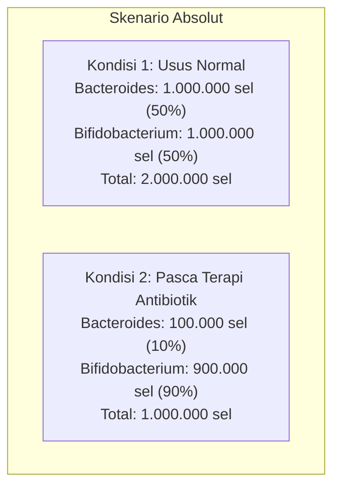
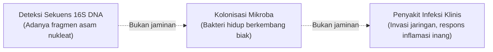

# Modul 06: Interpretasi Bertanggung Jawab & Batasan Klinis Mikrobioma

## 🎯 Target Pembelajaran
Setelah menyelesaikan modul ini, peserta mampu:
1. Menerapkan pola pikir dan kerangka pelaporan ilmiah yang bertanggung jawab: **Observasi $\rightarrow$ Angka $\rightarrow$ Ketidakpastian $\rightarrow$ Batas Kesimpulan**.
2. Memahami perbaruan nomenklatur taksonomi filum bakteri berdasarkan standar resmi **ICNP 2021**.
3. Mengevaluasi secara kritis keterbatasan rasio *Firmicutes/Bacteroidetes* (F/B) dan bahaya *over-simplification* biomarker mikrobioma.
4. Menjelaskan sifat komposisional data mikrobioma (*compositional data nature*) dan perbedaannya dengan konsentrasi absolut.
5. Membedakan secara tegas antara deteksi sekuens molekuler, kolonisasi mikroba, dan infeksi klinis aktif.
6. Menetapkan batasan etis antara analisis mikrobioma untuk **pendidikan/penelitian eksploratif** dengan **diagnostik klinis terakreditasi**.

---

## 1. Nomenklatur Filum Bakteri Resmi: Pembaruan ICNP 2021

Pada tahun 2021, *International Committee on Systematics of Prokaryotes* (ICSP) secara resmi memperbarui tata nama filum bakteri untuk menyelaraskan akhiran filum dengan aturan *International Code of Nomenclature of Prokaryotes* (ICNP) (Oren & Garrity, 2021):

| Nama Filum Historis (Literatur Lama & Basis Data Klasik) | Nama Filum Resmi ICNP 2021 (Standar Publikasi Terkini) | Genus Representatif Penting |
|---|---|---|
| **Firmicutes** | **Bacillota** | *Lactobacillus*, *Clostridium*, *Faecalibacterium*, *Enterococcus* |
| **Bacteroidetes** | **Bacteroidota** | *Bacteroides*, *Prevotella*, *Parabacteroides* |
| **Proteobacteria** | **Pseudomonadota** | *Escherichia*, *Klebsiella*, *Pseudomonas*, *Salmonella* |
| **Actinobacteria** | **Actinomycetota** | *Bifidobacterium*, *Corynebacterium*, *Mycobacterium* |

> [!NOTE]
> Database taksonomi seperti NCBI dan SILVA memiliki riwayat pembaruan yang bertahap. Ketika Anda menyusun naskah artikel ilmiah atau laporan penelitian saat ini, cantumkan nama resmi baru ICNP 2021 (mis. *Bacillota*) dan sebutkan sinonim lamanya dalam tanda kurung untuk transparansi dan ketertelusuran lintas literatur.

---

## 2. Kritik Ilmiah Terhadap Rasio Firmicutes / Bacteroidetes (F/B)

Rasio *Firmicutes/Bacteroidetes* (atau *Bacillota/Bacteroidota*) awalnya dipopulerkan pada tahun 2005–2006 dari eksperimen mencit model obesitas. Namun, konsensus sains mikrobioma manusia modern telah mengkritisi keras generalisasi ini:

### Mengapa Rasio F/B Tidak Layak Sebagai Biomarker Klinis Universal?
1. **Ketidakkonsistenan Lintas Kohort Manusia**: Meta-analisis skala besar terhadap ribuan subjek manusia di berbagai negara menunjukkan bahwa hubungan antara rasio F/B dan indeks massa tubuh (BMI) seringkali tidak signifikan, dan pada beberapa populasi bahkan berlawanan arah (Magne et al., 2020).
2. **Kelemahan Generalisasi di Tingkat Filum (*Lumping Problem*)**: Filum *Bacillota* mencakup ribuan spesies dengan fungsi metabolisme yang bertolak belakang. Menyatukan bakteri anti-inflamasi penghasil butirat (*Faecalibacterium prausnitzii*) dengan bakteri patogen oportunistik (*Clostridioides difficile*) ke dalam satu angka rasio filum mengaburkan informasi biologis penting.
3. **Konteks Mikrobioma Bayi (Dataset Kita)**: Pada feses bayi usia 3 bulan (dataset PRJNA637202), ekosistem usus belum matang dan secara alami didominasi oleh filum *Actinomycetota* (khususnya genus *Bifidobacterium*) yang memetabolisme oligosakarida susu ibu (HMO). Menghitung rasio F/B pada bayi usia dini tidak relevan secara fisiologis!

---

## 3. Sifat Komposisional Data: Kelimpahan Relatif $\neq$ Jumlah Sel Absolut

Data sekuensing 16S adalah **data komposisional** yang terikat pada jumlah konstan (total persentase = 100%):

$$\sum_{i} \text{proporsi}_i = 1.0 \quad (100\%)$$

Jika terjadi penurunan drastis pada genus *Bacteroides*, persentase *Bifidobacterium* akan terlihat melonjak menjadi 90%, **meskipun jumlah fisik sel *Bifidobacterium* sebenarnya tidak bertambah**!
Oleh sebab itu:
- Jangan pernah menyimpulkan bahwa takson mikroba "tumbuh lebih banyak" hanya berdasarkan peningkatan kelimpahan relatif.
- Pengukuran kelimpahan absolut membutuhkan kalibrasi tambahan di lab basah, seperti *spike-in internal control* sintetik atau penghitungan total bakteri via *quantitative PCR* (qPCR) gen 16S atau *flow cytometry*.

---

## 4. Deteksi Sekuens DNA $\neq$ Viabilitas $\neq$ Infeksi Klinis

Dalam mikrobiologi medis, terdapat perbedaan fundamental antara tiga fenomena:

1. **Deteksi DNA Tidak Menjamin Sel Hidup**: PCR 16S mendeteksi fragmen DNA dari sel yang sudah mati atau terdegradasi (*relic DNA*).
2. **Kolonisasi $\neq$ Infeksi**: Tubuh manusia dihuni oleh triliunan mikroba komensal dan oportunistik. Keberadaan sekuens DNA *Escherichia coli* atau *Enterococcus faecalis* di usus adalah kondisi fisiologis normal (kolonisasi), bukan indikasi infeksi aktif.
3. **Ketiadaan Gen Toksin & Resistensi pada 16S**: Gen 16S rRNA hanya penanda identitas taksonomi. Gen ini **tidak memberikan informasi** apakah bakteri tersebut membawa gen toksin (mis. toksin Shiga pada *E. coli*), faktor virulensi kapsul, atau gen resistensi antibiotik (AMR) seperti plasmid ESBL atau *carbapenemase*.

---

## 5. Batas Antara Riset Edukatif dan Diagnostik Klinis

> [!CAUTION]
> **Pernyataan Batas Klinis Mutlak**:
> Alur kerja bioinformatika yang diajarkan dalam workshop ini adalah **alat eksplorasi akademik dan edukasi**, dan **TIDAK TERVALIDASI SECARA KLINIS** untuk:
> 1. Menentukan diagnosis medis individual pasien.
> 2. Memandu keputusan pemilihan terapi antibiotik atau intervensi medis.
> 3. Dijadikan rujukan rekam medis tanpa pengujian laboratorium terakreditasi (ISO 15189 / CAP / CLIA).
> 
> Pengambilan keputusan klinis memerlukan alur kerja diagnostik teregulasi, validasi batas deteksi analitis (*Limit of Detection* [LoD]), pemantauan kontaminasi negatif yang terakreditasi, dan verifikasi fenotipe mikrobiologi kultur standar.

---

## 6. Kerangka Berpikir Pelaporan yang Bertanggung Jawab

Saat menuliskan laporan atau naskah publikasi, gunakan pola 4 langkah:

1. **Observasi**: *"Berdasarkan profil genus dari 12 sampel feses bayi usia 3 bulan..."*
2. **Angka Objektif**: *"Median kelimpahan relatif genus Bacteroides terukur sebesar 18.4% pada kelompok persalinan vaginal dibandingkan 0.2% pada kelompok sesar (Mann–Whitney U = 2.0, p = 0.0087, q = 0.042)..."*
3. **Ketidakpastian & Faktor Perancu**: *"Namun demikian, ukuran sampel pada demonstrasi ini terbatas ($n=6$ per kelompok) dan kovariat klinis penting seperti pola pemberian ASI dan penggunaan antibiotik maternal tidak dikontrol dalam subset ini..."*
4. **Batas Kesimpulan**: *"Oleh karena itu, temuan ini menunjukkan asosiasi perbedaan komposisi awal mikrobioma usus dan tidak dapat disimpulkan sebagai hubungan kausalitas langsung dari metode persalinan."*

